<div align="center">

# GuraNeza

**Shop Smart in Kigali, Rwanda** — a MERN e-commerce platform evolving into a secure multi-vendor marketplace.

[](https://github.com/Kevin-The-Cyber-Coder/GuraNeza/actions/workflows/ci.yml)
[](https://nodejs.org/)
[](https://react.dev/)
[](https://www.mongodb.com/)
[](https://expressjs.com/)
[](LICENSE)

[Live Storefront](https://guraneza-ja1a.onrender.com/) · [API Health](https://guraneza-api.onrender.com/api/health) · [Report Issue](https://github.com/Kevin-The-Cyber-Coder/GuraNeza/issues) · [Contributing](CONTRIBUTING.md)

</div>

---

## Overview

GuraNeza ("buy well" in Kinyarwanda) is a full-stack commerce platform built for Rwanda. It currently delivers a customer storefront, admin console, secure authentication, order management, seller application/onboarding flows, and a growing marketplace foundation. The project is being upgraded incrementally into a full multi-vendor marketplace with strict role-based access control.

> **Status:** Active development on `develop`. Production deploys from `main` via Render.

## Table of Contents

- [Live Links](#live-links)
- [Features](#features)
- [Screenshots](#screenshots)
- [Tech Stack](#tech-stack)
- [Architecture](#architecture)
- [Project Structure](#project-structure)
- [Getting Started](#getting-started)
- [Environment Variables](#environment-variables)
- [Available Scripts](#available-scripts)
- [API Overview](#api-overview)
- [Security](#security)
- [Deployment](#deployment)
- [Testing & Quality](#testing--quality)
- [Roadmap](#roadmap)
- [Contributing](#contributing)
- [License](#license)

## Live Links

| Resource | URL | Notes |
|---|---|---|
| Storefront | https://guraneza-ja1a.onrender.com/ | Render Static Site |
| API | https://guraneza-api.onrender.com | Render Web Service |
| API Health | https://guraneza-api.onrender.com/api/health | Public health check |

> Do not commit real credentials. Use demo/seed accounts only in local development.

## Features

### Customer Storefront
- Responsive landing page, shop catalogue, search/filter/sort/pagination.
- Product detail pages with related products and stock-aware purchasing.
- Cart, checkout, order confirmation, order history, and guest order tracking.
- Contact form and storefront information pages.

### Admin Console
- Secure admin login and protected admin routes.
- Dashboard metrics and recent activity.
- Product, order, contact/message, and seller application management.
- Seller approval workflow with secure activation invitations.

### Seller / Marketplace Foundation
- Seller application submission and status tracking.
- Admin review: approve/reject with reason, resend invitation.
- Secure activation token flow (hashed, single-use, expiring).
- Seller shop profile and seller-scoped product management foundations.
- Local image upload fallback; Cloudinary-ready storage interface.

### Platform / Engineering
- JWT authentication, bcrypt password hashing, role-based authorization.
- Zod/config validation, Helmet, CORS allow-list, rate limiting.
- Audit logging for privileged actions.
- Idempotent migrations and transaction-aware service patterns.
- CI workflow for lint/test/build.

## Screenshots

> Captured from a local development build (headless Chrome). Data-dependent views may appear empty without a running API/database.

| Homepage | Shop |
|---|---|
| 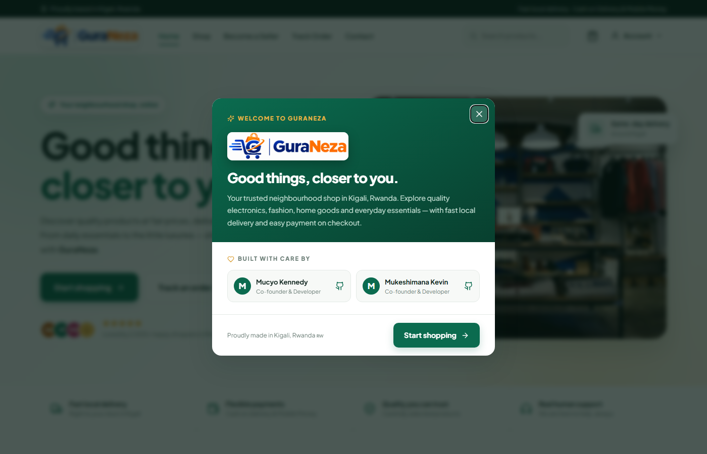 | 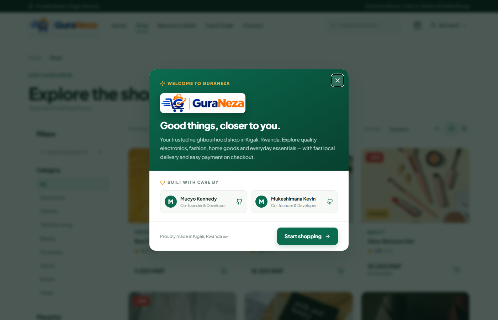 |

| Product Detail | Cart |
|---|---|
| 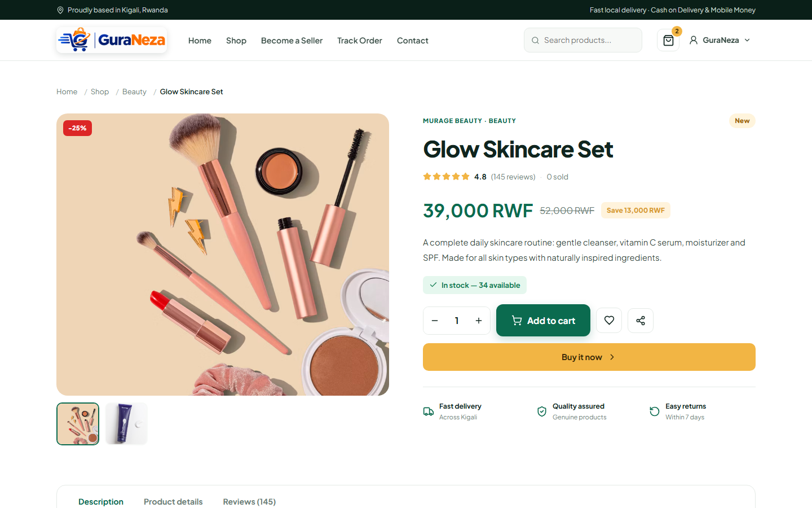 | 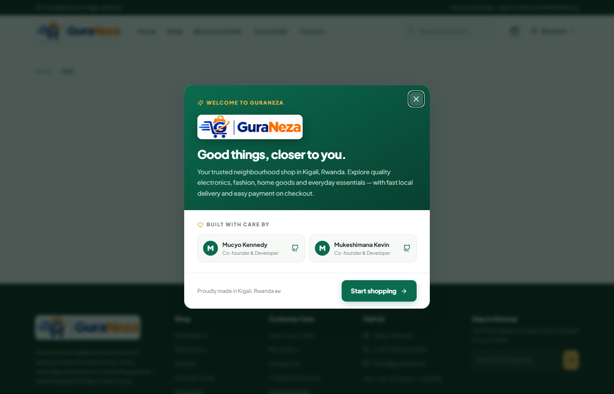 |

| Login | Register |
|---|---|
| 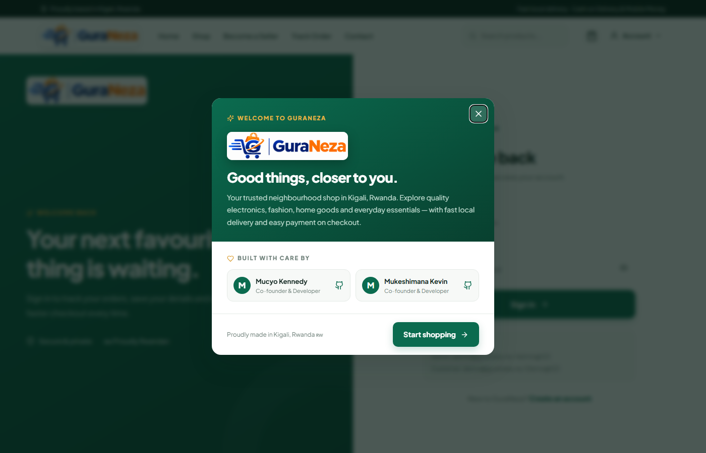 | 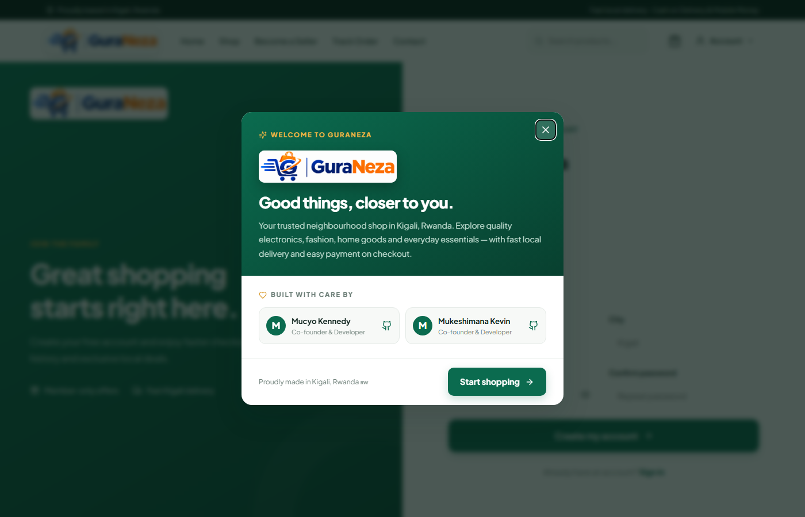 |

| Become a Seller | Contact |
|---|---|
| 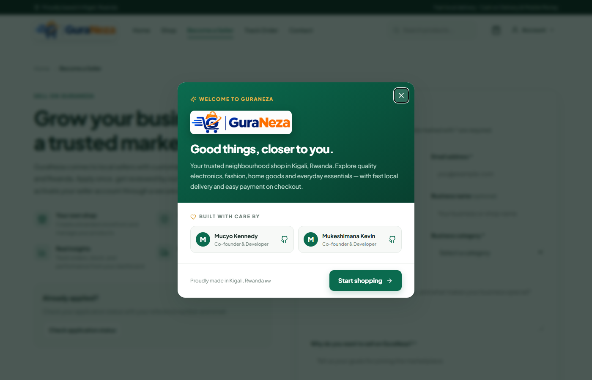 | 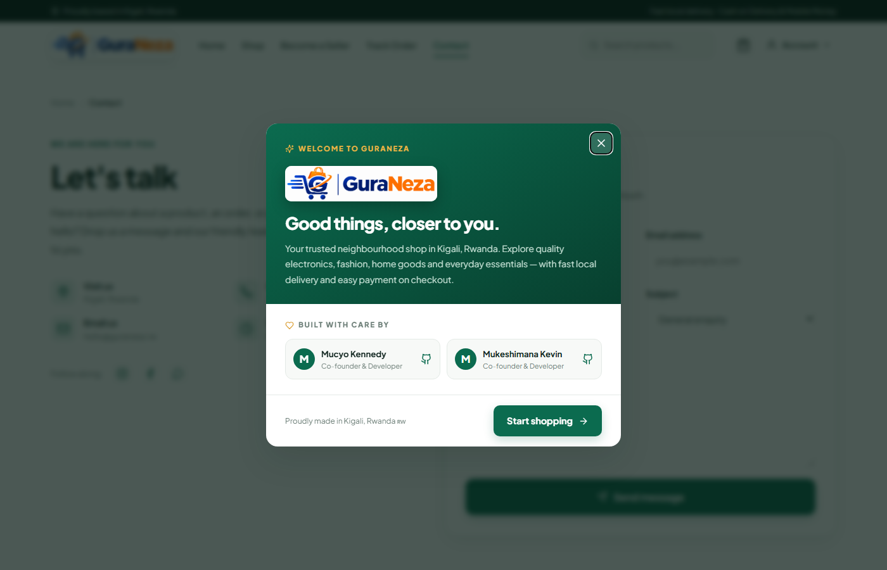 |

| Track Order | Admin Dashboard |
|---|---|
| 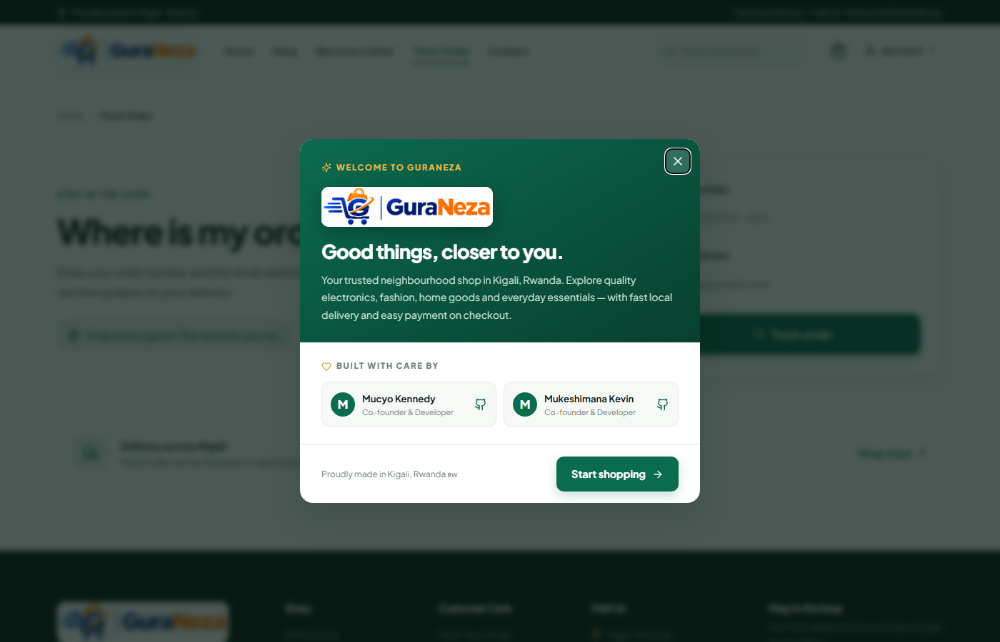 | 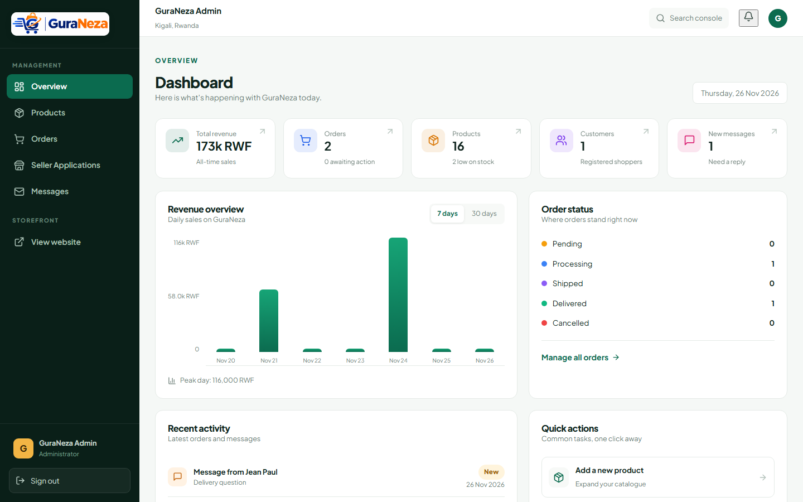 |

| Mobile Home |
|---|
| 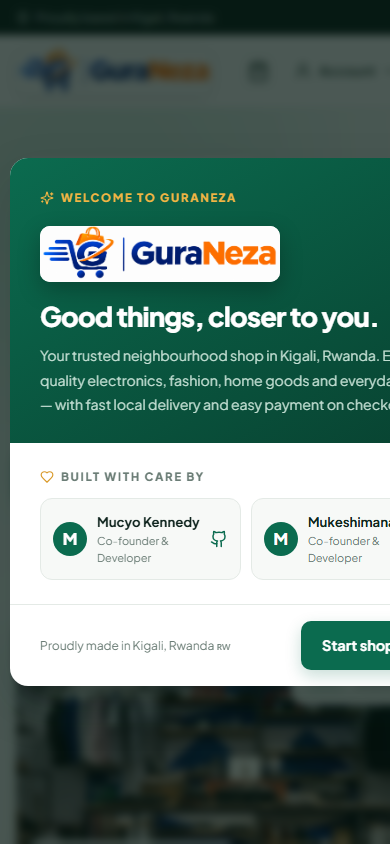 |

More capture guidance: [docs/screenshots/README.md](docs/screenshots/README.md).

## Tech Stack

| Layer | Technology |
|---|---|
| Frontend | React 18, Vite, React Router, Context API, Lucide React |
| Backend | Node.js, Express 4, Mongoose 8 |
| Database | MongoDB / MongoDB Atlas |
| Auth & Security | JWT, bcryptjs, Helmet, CORS, express-rate-limit, Zod |
| Email | Resend HTTP API |
| Storage | Local disk fallback, Cloudinary-ready interface |
| Testing | Vitest, Supertest, mongodb-memory-server |
| Tooling | ESLint, Prettier, Husky, lint-staged, GitHub Actions |
| Deployment | Render Blueprint (`render.yaml`) |

## Architecture

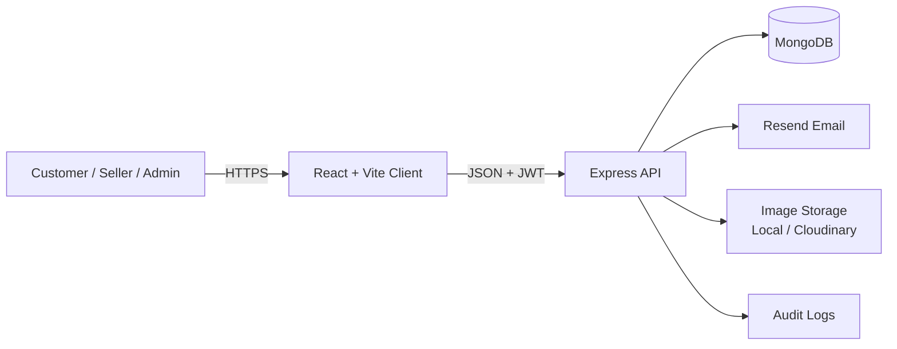

### RBAC Direction (target)

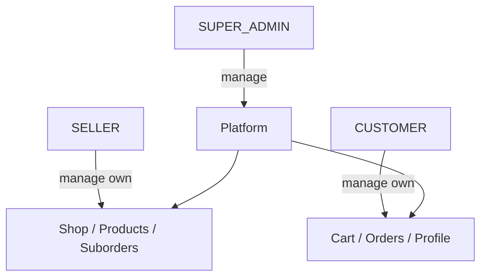

Detailed architecture and domain model: [docs/ARCHITECTURE.md](docs/ARCHITECTURE.md).

## Project Structure

```text
GuraNeza/
├── .github/                 # CI workflows and templates
├── client/                  # React storefront + admin/seller UI
│   └── src/
│       ├── components/
│       ├── context/
│       ├── pages/
│       ├── services/
│       └── utils/
├── docs/                    # Architecture, API, deployment, screenshots
├── server/                  # Express REST API
│   └── src/
│       ├── config/
│       ├── controllers/
│       ├── middleware/
│       ├── migrations/
│       ├── models/
│       ├── routes/
│       ├── services/
│       ├── tests/
│       └── utils/
├── package.json             # Workspace scripts
└── render.yaml              # Render deployment blueprint
```

## Getting Started

### Prerequisites

- Node.js 20+ (CI uses Node 22)
- npm
- MongoDB (local or Atlas replica set recommended)
- Git

### 1. Clone and install

```bash
git clone https://github.com/Kevin-The-Cyber-Coder/GuraNeza.git
cd GuraNeza
npm run install:all
```

### 2. Configure environment

```bash
# Windows PowerShell
Copy-Item server/.env.example server/.env
```

Set at minimum `MONGO_URI` and `JWT_SECRET` in `server/.env`.

### 3. Seed demo data

```bash
npm run seed
```

### 4. Run development servers

```bash
npm run dev
```

- Storefront: http://localhost:5173
- API: http://localhost:5000/api/health

### Demo accounts (local seed)

| Role | Email | Password |
|---|---|---|
| Admin | `admin@guraneza.rw` | `Admin@123` |
| Customer | `demo@guraneza.rw` | `Demo@123` |

## Environment Variables

See [`server/.env.example`](server/.env.example) for the full list. Key variables:

| Variable | Required | Purpose |
|---|---|---|
| `MONGO_URI` | Yes | MongoDB connection string |
| `JWT_SECRET` | Yes | JWT signing secret (long random value) |
| `JWT_EXPIRES_IN` | No | Token expiry, default `30d` |
| `CLIENT_URL` | No | Allowed CORS origin(s) |
| `APP_URL` | No | Public app URL used in emails |
| `RESEND_API_KEY` | No | Transactional email delivery |
| `CLOUDINARY_*` | No | Hosted image uploads |
| `ADMIN_EMAIL/PASSWORD/NAME` | No | Seed/bootstrap admin |

## Available Scripts

From repository root:

| Command | Description |
|---|---|
| `npm run install:all` | Install root, server, and client dependencies |
| `npm run dev` | Run server and client concurrently |
| `npm run dev:server` | Run API only |
| `npm run dev:client` | Run client only |
| `npm run build` | Build client |
| `npm run build:client` | Build client (CI alias) |
| `npm run lint` | Lint repository |
| `npm run format` | Format with Prettier |
| `npm run test:server` | Run server tests |
| `npm run seed` | Seed demo data |

## API Overview

Base URL: `http://localhost:5000/api` (local) or `https://guraneza-api.onrender.com/api` (live).

| Method | Endpoint | Access | Description |
|---|---|---|---|
| POST | `/auth/register` | Public | Register customer |
| POST | `/auth/login` | Public | Login |
| GET | `/auth/me` | Private | Current user |
| GET | `/products` | Public | List/search products |
| POST | `/products` | Admin/Seller | Create product (role-scoped) |
| GET | `/orders/my-orders` | Private | Customer orders |
| POST | `/orders` | Public | Place order (server validates prices) |
| GET | `/seller-applications` | Admin | List seller applications |
| POST | `/seller-applications` | Public | Submit seller application |
| GET | `/shops/:slug` | Public | Public shop profile |

Detailed docs: [docs/API.md](docs/API.md). Postman artifacts: [postman/](postman/).

## Security

- Passwords hashed with bcrypt; password hashes never returned.
- JWT auth verified server-side; RBAC enforced on API routes.
- Server-side ownership checks for sensitive resources.
- Zod/input validation, Helmet headers, CORS allow-list, rate limiting.
- Seller invitation tokens stored as hashes; raw tokens not persisted.
- Audit logs for privileged actions.
- No secrets committed; `.env` files ignored.

See [SECURITY.md](SECURITY.md) for vulnerability reporting.

## Deployment

Render deployment is defined in [`render.yaml`](render.yaml). See [docs/DEPLOYMENT.md](docs/DEPLOYMENT.md) for full steps.

Key notes:
- Set Render SPA rewrite: `/* -> /index.html` as **Rewrite** (not Redirect).
- Set `VITE_API_URL` at client build time.
- Keep `JWT_SECRET` stable across deploys.
- MongoDB replica set is required for transactions.

## Testing & Quality

```bash
npm run lint
npm run test:server
npm run build:client
```

CI runs on pull requests and pushes to `main`/`develop` via [`.github/workflows/ci.yml`](.github/workflows/ci.yml).

## Roadmap

- [ ] Complete SUPER_ADMIN / SELLER / CUSTOMER RBAC enforcement across all modules
- [ ] Admin shop management and public shop discovery
- [ ] Multi-vendor cart, checkout, parent orders and seller suborders
- [ ] Payments, commissions, payouts, delivery management
- [ ] Coupons, flash sales, wishlist, reviews, notifications
- [ ] Analytics, disputes, audit/security dashboards
- [ ] Cloudinary production media storage

## Contributing

Please read [CONTRIBUTING.md](CONTRIBUTING.md). Use Conventional Commits, branch from `develop`, add tests, and never commit secrets.

## License

Proprietary. See [LICENSE](LICENSE).
